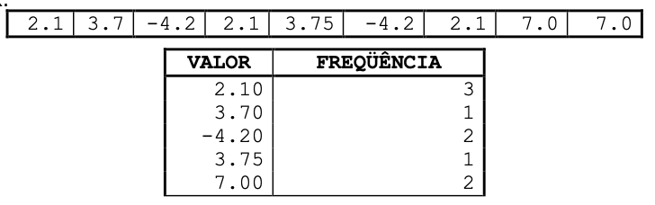

# Lista de Exercícios - Unidade 7 - Tipos Estruturados Unidimensionais

Implemente  uma  classe  com  o  método  main  para  cada  um  dos seguintes  exercícios utilizando o VSCode. Faça a análise do problema identificando as entradas, saídas e testes. Utilize  somente  os  comandos  que  você  aprendeu  na  disciplina  até  o  momento  para  a resolução das atividades.

Utilize o nome do arquivo Java e da Classe de acordo com o indicado no inicio de cada enunciado.

E agora podemos usar métodos para resolver os exercícios abaixo.

----------

## Vetores de Tamanho definido no código

----------

**Uni7Exe01.java** - Descreva um algoritmo que leia 10 números inteiros e os coloque em um vetor de 10 posições do tipo inteiro. Escreva na ordem inversa em que foram lidos. Faça um método para ler e outro para escrever.

----------
**Uni7Exe02.java** - Descreva um algoritmo que leia 12 valores reais e os coloque em um vetor de 12 posições do tipo real. Imprima quais valores desses informados são maiores que a média dos valores. Faça um método para ler os valores, outro para calcular a média e outro para informar os valores maiores que a média.

----------
**Uni7Exe03.java** - Descreva um algoritmo que leia 12 valores reais e os coloque em um vetor de 12 posições do tipo real. Em seguida, modifique o vetor de modo que os valores das posições ímpares sejam aumentados em 5% e os das posições pares sejam aumentados em 2%. Imprima o vetor resultante. Faça um método para ler os valores, outro para ajustar os valores dentro do vetor e outro para escrever os valores atualizados do vetor.

----------
**Uni7Exe04.java** - Faça um programa para ler os valores de dois vetores de inteiros, cada um contendo 10 elementos. Crie um terceiro vetor em que cada elemento é a soma dos valores contidos nas posições respectivas dos vetores originais. Por exemplo, vetor1 = \[1,2,3] vetor2 = \[1,5,6] vetor3 = \[2,7,9]. Exiba, ao final, os três vetores na tela. Faça três métodos: um método para ler valores dos vetores, outro para somar e outro para escrever os vetores.

----------
**Uni7Exe05.java** - Com o objetivo de determinar o índice de afinidade entre um rapaz e uma moça cada um respondeu um questionário com 5 perguntas, como por exemplo:

- Gosta de música sertaneja?
- Gosta de futebol?
- Gosta de seriados?
- Gosta de redes sociais?
- Gosta da Oktoberfest?

A resposta a cada pergunta pode ser: SIM, NÃO ou IND (indiferente). O índice de afinidade é medido da seguinte maneira:

- se ambos deram a mesma resposta soma-se 3 pontos ao índice;
- se um respondeu IND e o outro SIM ou NÃO soma-se 1;
- se um respondeu SIM e o outro NÃO subtrai-se 2 ao índice.

Crie  um  vetor  para  armazenar  as  respostas  do  rapaz  e  outro  para  armazenar  as respostas da moça. Crie um método que possa ler tanto as respostas do rapaz como da moça, e outro para calcular e retornar  a  afinidade.  Por  fim, escreva  a  afinidade  considerando  os  seguintes intervalos:

| Afinidade | Mensagem                          |
|-----------|-----------------------------------|
| 15        | “Casem!                           |
| 10 a 14   | “Vocês têm muita coisa em comum!” |
| 5 a 9     | “Talvez não dê certo :(”          |
| 0 a 4     | “Vale um encontro.”               |
| -1 a -9   | “Melhor não perder tempo”         |
| -10       | “Vocês se odeiam!”                |

----------

## Vetores de Tamanho informado

----------
**Uni7Exe06.java** - Faça um programa que leia um valor N inteiro. Com base neste valor, crie um vetor do tipo real. Em seguida, solicite ao usuário informar essa quantidade N de valores reais para popular o vetor. Após ter preenchido o vetor, solicite que o usuário informe um outro valor real. Informe para o usuário se este valor informado se encontra cadastrado no vetor. Faça  um  método  para  ler  o  vetor e outro, que retorne verdadeiro ou falso, para encontrar o valor.

----------
**Uni7Exe07.java** - Faça um programa que leia um valor N inteiro limitado a 20 posições. Com base neste valor, crie um vetor do tipo inteiro. Em seguida, solicite ao usuário para digitar um número inteiro várias vezes, até preencher o vetor. Esse número deverá ser armazenado no vetor caso ainda não exista, e se o valor já existir deve ser pedido um novo valor. Isto é, se o usuário informar o número 2 e já existir o número 2 em alguma posição do vetor, o número não deve ser adicionado. Após ter adicionado todos os números dentro do vetor, o mesmo deve ser ordenado. Para isso reordene os elementos internos do vetor de modo que este fique em ordem crescente, conforme no exemplo:

Vetor origem: \[0]\[4]\[2]\[6]\[3]  
Vetor ordenado: \[0]\[2]\[3]\[4]\[6]

Crie um método para inserir os valores no vetor, outro para ordenar o vetor e outro para informar o vetor resultante. Para "método ordenar" se pode usar o "método bolha" explicado neste [VideoAula_6_bolha](<https://furb.sharepoint.com/:v:/t/msteams_d5eac5-TCCsDSC/IQAasM4czkVWSIXgdtS7W9k4ARfiSYbBmljv5DI4uo8Ht8s?e=DVVFKI>).

----------
**Uni7Exe08.java** - Faça um programa que leia um valor N inteiro limitado a 20 posições. Com base neste valor, crie um vetor do tipo real. Faça o usuário informar valores para as posições deste vetor e coloque-as nas posições na sequência informada pelo usuário. Imprima  uma tabela contendo cada valor diferente e o número de vezes que o valor aparece no vetor (veja exemplo a seguir).

----------
**Uni7Exe09.java** - Um cinema pretende fazer uma pesquisa para avaliar o grau de satisfação de seus clientes. Trinta deles foram ouvidos e para cada um perguntou-se o sexo (1=feminino 2=masculino), uma nota para o cinema (zero até dez, valor inteiro) e a idade.

Baseado nisto faça um programa que informe:

- qual a nota média recebida pelo cinema;
- qual a nota média atribuída pelos homens;
- qual a nota atribuída pela mulher mais jovem;
- quantas das mulheres com mais de 50 anos deram nota superior a média recebida pelo cinema.

Utilize os conceitos aprendidos sobre vetores (ou mesmo o uso de matriz) e métodos para a resolução deste exercício.

----------
**Uni7Exe10.java** - Dado um vetor de números inteiros, com capacidade limitada a 50 elementos, faça um programa que construa um menu com as seguintes opções:

- “1 – Incluir valor”: nesta opção inclua o valor no fim do vetor, se houver espaço. Informe o usuário se o valor foi incluído no vetor ou não;
- “2 – Pesquisar valor”: nesta opção leia um valor e informe se o mesmo está no vetor;
- “3 – Alterar valor”: nesta opção informe um número a ser alterado e um novo número a ser colocado no lugar (só para a primeira ocorrência deste número). Caso o número a ser alterado exista no vetor, substitua-o pelo novo número. Caso contrário, informe “número não encontrado”;
- “4 – Excluir valor”: nesta opção leia um valor e, caso ele esteja no vetor, exclua-o. Informe o usuário se o valor foi excluído do vetor ou não. A posição que foi excluída o valor deve ser preenchida pelo valor seguinte, sucessivamente até o final dos valores do vetor;
- “5 – Mostrar valores”: nesta opção mostre todos os valores armazenados no vetor;
- “6 – Ordenar valores”: ordene todos os valores do vetor em ordem crescente;
- “7 – Inverter valores”: desafio (ver abaixo);  
- “8 – Sair do sistema”: nesta opção deve ser finalizada a execução do programa.

Faça um método para cada uma das opções do menu. O menu deve-se repetir até que o usuário escolha a opção 8.  
Para a opção "6 - Ordenar valores" se pode usar o "método bolha" explicado neste [vídeo](https://furb-my.sharepoint.com/:v:/g/personal/dalton_furb_br/EVyXhyhfMCxOjjJRsle-OzgBE1LlUgc-ZCWYvTlCPa0gyA?e=HZAWSm). Existem também outros vídeos que mostram a lógica de ordenação usando o "método bolha", no caso é só procurar por "Bubble Sort". Um deles é [Bubble Sort | GeeksforGeeks](<https://www.youtube.com/watch?v=nmhjrI-aW5o> "Bubble Sort | GeeksforGeeks"). Um outro um pouco mais "divertido" procura mostrar a lógica usando uma coreografia de dança: [Bubble sort with Hungarian, folk dance](https://www.youtube.com/watch?v=Iv3vgjM8Pv4 "Bubble sort with Hungarian, folk dance"). E, por fim, tem uma forma interativa e visual com explicação em: <https://www.hackerearth.com/practice/algorithms/sorting/bubble-sort/visualize/>.  

**Desafio:** adapte o código acima para ter mais uma opção no menu para também poder inverter os elementos dentro de um vetor. Assim o último elemento passa a ser o primeiro, o penúltimo passa ser o segundo, e assim sucessivamente para todos os elementos da lista. Mas lembre, não se deve considerar o vetor inteiro, mas somente os elementos que já foram adicionados no vetor. Como base use o código descrito em [vetorInverter.java](https://gist.github.com/dalton-reis/1c5f2bdf65b251730e1cb76c5a61bb1b).

----------

**Uni7Exe11.java** Uma startup precisa medir a previsibilidade e a estabilidade do seu negócio. Para isso, a empresa monitora o faturamento diário durante um período de 7 dias para descobrir a média semanal e o desvio padrão da receita. Como estagiário de Ciência de Dados, você ficou encarregado de criar duas sub-rotinas para automatizar essa análise: 

a) double calcularMedia(double[] dados): Deve calcular e retornar a média aritmética dos valores. 

b) double calcularDesvioPadrao(double[] dados, double media): Deve calcular e retornar o desvio padrão dos dados. 

Obs.: desvio padrão é uma medida que indica o quanto os valores de um conjunto de dados se afastam da média, indicando a consistência dos resultados. Para calcular o desvio padrão siga os seguintes passos: calcule a média dos valores; realize a seguinte operação para cada valor do conjunto (n-média) ²; some os resultados obtidos na última conta; divida o resulta da soma pelo número de elementos; por último, faça a raiz quadrada do último valor. 

**Uni7Exe12.java** O sensor de presença de uma loja de conveniência registrou o número de clientes a cada duas horas durante um dia inteiro. No entanto, houve uma falha no sistema e algumas leituras foram corrompidas, gerando valores negativos. Crie uma sub-rotina para realizar o tratamento desses dados corrompidos. A função deve receber o vetor original, gerar e retornar um novo vetor totalmente íntegro, ou seja, um vetor que mantenha os dados corretos e substitua todos os valores negativos por 0. 

**Uni7Exe13.java** m grupo de cinéfilos está organizando uma ação de Dia dos Namorados para avaliar a compatibilidade de casais com base nas preferências de filmes. PO programa deve receber, de forma individual, uma nota de 1 a 5 para cinco filmes. Escreva uma sub-rotina que receba o vetor de notas da pessoa A e o vetor de notas da pessoa B. A função deve calcular a diferença absoluta (sem sinal negativo) entre as notas de cada filme e gerenciar um medidor de afinidade (que começa em 0) seguindo as regras abaixo:

- Se a diferença for igual a 0 (mesma nota): Adicione 3 pontos ao medidor.

- Se a diferença for de 1 ou 2 (notas próximas): Adicione 1 ponto ao medidor.

- Se a diferença for igual ou maior que 3 (gostos muito distantes): Subtraia 2 pontos do medidor.

Se a diferença for igual ou maior que 3 (gostos muito distantes): Subtraia 2 pontos do medidor. 

**Uni7Exe14.java** Em uma turma de Ciência de Dados, o professor solicitou que os alunos desenvolvessem um conversor decimal para binário. Em suas especificações o professor informou que: 

- O usuário deve digitar um número inteiro no formato decimal que deseja transformar.

- A sub-rotina valorConvertido realizará a conversão e retornará um vetor de inteiros contendo a representação do número em binário.

- O programa principal deve receber esse vetor retornado e imprimir o resultado final formatado na tela.

**Uni7Exe15.java** Bancos de dados e tabelas precisam permitir que novos dados entrem, sejam encontrados e também deletados quando um cliente cancela o serviço. Você deve permitir que o usuário armazene até 10 IDs (valores inteiros) em um vetor, onde o valor 0 representa uma posição vazia. Com base nisso, crie uma sub-rotina para cada uma das situações abaixo: 

- Verificar a existência de um ID.
  
- Remover um ID.
  
- Adicionar um ID, caso ainda haja espaço disponível.

**Uni6Exe11.java** Em empresas de tecnologia e e-commerce, o controle de estoque é automatizado por sistemas que atualizam bases de dados em tempo real. Para facilitar a operação, os produtos são identificados diretamente por seus nomes, e o sistema deve ser capaz de localizar as quantidades em estoque correspondentes. Crie um programa que gerencie um estoque de 5 itens, armazenando o nome dos itens e a quantidade em estoque. O programa principal deverá conter um menu com as seguintes opções: 

1 – Procurar item. 

2 – Adicionar item. 

3 – Retirar item. 

4 – Sair.	 

Para cada opção do menu, com exceção da opção 4, uma sub-rotina diferente deverá ser acionada, e o usuário deverá ser informado sobre o resultado da ação realizada. 

**Uni6Exe12.java** Em segurança de dados, antes de liberar o acesso a um relatório ou banco de dados confidencial, o sistema precisa verificar se o usuário que está tentando logar possui permissão ativa na empresa. Com base nos usuários armazenados que possuem acesso autorizado ao sistema, você deverá criar a sub-rotina booleana verificarPermissao(String[] lista, String usuarioTentandoAcesso), que deve retornar:  

- True, para “Acesso Autorizado”; 

- False para “Acesso Negado”.  

Após a verificação, o usuário que está tentando acessar deverá receber a seguinte mensagem: “Olá, usuário y. Seu acesso foi permitido/negado.” 

**Uni7Exe16.java** Um laboratório de biomedicina recebe diariamente lotes de insumos refrigerados (como vacinas, amostras de sangue e reagentes) vindos de fornecedores globais. Como cada fornecedor utiliza uma unidade de medida diferente — Celsius (°C), Fahrenheit (°F) ou Kelvin (K) —, o laboratório precisa padronizar todas as temperaturas de um lote em uma única unidade escolhida pelo biomédico para conseguir gerar os relatórios de controle de qualidade. Desenvolva um programa em Java que armazene em um vetor 5 temperaturas em Celsius vindas do relatório de um fornecedor. No programa principal, o sistema deve perguntar ao usuário para qual unidade ele deseja converter o lote atual, exibindo as seguintes opções: 

- Digite 1 para converter para Fahrenheit (°F) 

- Digite 2 para converter para Kelvin (K) 

Com base na escolha do usuário, o programa principal deve acionar a sub-rotina correspondente, passar o vetor original como parâmetro e, por fim, imprimir o novo vetor com as temperaturas já convertidas e formatadas 

- Fórmula 1: F = (Celsius * 1.8) + 32  

- Fórmula 2: K = Celsius + 273.15

**Uni7Exe17.java** Em sistemas de design, edição de imagens e análise de dados visuais, as cores secundárias são geradas a partir da combinação de cores primárias. Crie um sistema que simule a mistura de tintas com base nas três cores primárias tradicionais: Azul, Amarelo e Vermelho. Desenvolva um programa em Java que armazene em um vetor de String com duas posições as cores informadas pelo usuário. No programa principal, o sistema deve pedir para o usuário digitar duas cores primárias diferentes e guardá-las nesse vetor. Com base nas cores informadas, o programa principal deve acionar a sub-rotina correspondente, passar o vetor original como parâmetro e, por fim, imprimir na tela o nome da cor resultante obtida com a mistura.

- String descobrirMistura(String[] cores): deve receber o vetor com as duas cores digitadas, analisar a combinação e retornar uma única String com o nome da cor gerada. 

- Azul e Vermelho deve retornar "Roxo". 

- Azul e Amarelo deve retornar "Verde". 

- Amarelo e Vermelho deve retornar "Laranja".

- Se o usuário digitar alguma cor que não seja primária ou repetir a mesma cor nas duas posições, a função deve retornar a mensagem "Combinação inválida".

**Uni7Exe18.java** A equipe de veterinários e nutricionistas de um zoológico precisa monitorar de perto a alimentação dos animais para garantir que todos recebam os nutrientes adequados. Cada espécie possui uma quantidade diária recomendada de ração (em quilos). Porém, dependendo do comportamento ou do estado de saúde do animal, os tratadores precisam atualizar esses valores no sistema de forma rápida. Desenvolva um programa que armazene os nomes das espécies e a quantidade diária de ração de cinco animais do zoológico. Com base no animal informado pelo usuário, crie sub-rotinas para: 

- Verificar se o animal está cadastrado. 

- Caso o animal esteja cadastrado, atualizar a quantidade de ração diária conforme informado pelo usuário. 

Ao final, o programa deverá imprimir o nome de cada animal e a respectiva quantidade de ração em kg. 

